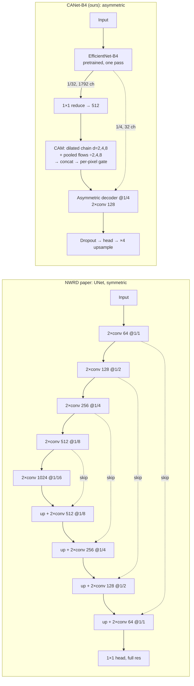

# Experimental protocol: CANet-B4 against the NWRD paper's baselines

*Final, 2026-10-18.* This document states what was compared and how, so that every number in
[`results.md`](results.md) can be checked and the experiments repeated. The baseline paper is
summarised, with its figures and a check of its claims, in [`paper_summary.md`](paper_summary.md).

---

## 1. Question and models

**Question.** Does CANet with an ImageNet-pretrained EfficientNet-B4 encoder (CANet-B4, "ours")
segment wheat stripe rust more accurately or more efficiently than the architecture of the NWRD
paper (Anwar et al., *The NWRD Dataset*, Sensors 23(15):6942, 2023), and than DeepLabV3+ with a
ResNet-50 encoder?

| Model (`nwrd/models.py`) | Role | Encoder | Pretraining |
|---|---|---|---|
| `canet_b4` | **Ours** | EfficientNet-B4 | ImageNet |
| `unet` | The NWRD paper's architecture (4 encoder / 4 decoder blocks), re-trained under this protocol | Plain conv blocks, 64→1024 channels | None |
| `deeplabv3plus_r50` | Second baseline: a standard DeepLabV3+ (segmentation-models-pytorch), standing in for the internship's "Custom DeepLabV3+" | ResNet-50 | ImageNet |
| `unet_tuned` | Control: `unet` with its own learning rate (1e-3), in case the shared rate under-trains a from-scratch network | As `unet` | None |
| `deeplabv3plus_b4` | Same-encoder ablation; defined but not trained (GPU budget) | EfficientNet-B4 | ImageNet |

**On the DeepLabV3+ baseline.** The project's earlier internship work reported a "Custom
DeepLabV3+" with a ResNet-50 encoder (trained on 224px patches resized to 512, with 5–10% of the
background patches). Its code was not preserved: neither the repository's history nor the
project files hold it, and the report does not say what was customised. `deeplabv3plus_r50` is
therefore the standard DeepLabV3+ R50 of segmentation-models-pytorch 0.5.0, trained under this
protocol like every other model. Its results are this study's, not a reproduction of the
internship's (§7).

**Two experiments** use the same protocol and differ only in input scale:

| Experiment | Input | Models | Results |
|---|---|---|---|
| `main` | 512×512 patches at native resolution | `canet_b4`, `unet`, `deeplabv3plus_r50` (3 seeds each), `unet_tuned` (seed 42) | `results/512px/final/` |
| `128px` | The paper's scale: each patch halved (Lanczos) and cut into 2×2 tiles of 128×128 | `canet_b4`, `unet`, `deeplabv3plus_r50` (3 seeds each) | `results/128px/final/` |

The settings of both are in `nwrd/config.py` (`Config` and `PRESETS`); `config.json` in each
results folder records what the runs actually used.

---

## 2. Architectures

### 2.1 CANet-B4 and where its design comes from

"CANet" names several unrelated networks. The project's reference, Shoaib et al. (2022, *Frontiers
in Plant Science* 13:1095547), describes a "context-encoded" lesion-segmentation network only in
outline: an encoder, a context module and a decoder, with no backbone or layers. The buildable
design our modules are adapted from is the Chained Context Aggregation Network of Tang et al.
(arXiv:2002.12041). CANet-B4 keeps that design's ingredients and changes most of them:

| Component | Tang et al. | **CANet-B4** (`nwrd/models.py`) | Why |
|---|---|---|---|
| Encoder | ResNet-101, dilated, features at 1/8 | **EfficientNet-B4**, ImageNet-pretrained, no dilation: 1/32 features (1792 ch, reduced to 512 by a 1×1 conv) and 1/4 features (32 ch) | 100 photographs are few, so pretrained features help; a 1/32 map makes the context module cheap |
| Global context | Global average pooling → one image-level vector | **Serial dilated chain**: three 3×3 convs at dilation 2, 4, 8 (`CAM.global_flow`) | Keeps the spatial layout; a rust stripe along a leaf is a spatial pattern |
| Region context | Four chained context flows at pooling scales 2/4/8/16 | **Three parallel context flows** at scales 2/4/8: average pool, two conv-BN-ReLU, bilinear upsample (`ContextFlow`) | The 1/32 map is 16×16 at 512px; a 16× pool would leave one value |
| Fusion | Concatenation, then a channel-attention feature-selection module (one weight per channel) | Concatenation and a 1×1 conv to 256 ch, then a **per-pixel gate**: two 1×1 convs and a sigmoid, a weight for every channel at every position (`AttentionFusion`) | Can switch context off over background while keeping it on leaves |
| Decoder | Asymmetric, DeepLabV3+-style | Asymmetric: context upsampled to 1/4, concatenated with the 1/4 features (32 → 48 ch), two 3×3 convs at 128 ch (`AsymmetricDecoder`) | Compute goes to deep context, not to full-resolution decoding |
| Head | Multi-class | One logit per pixel; Dropout2d (p 0.5), 3×3 → 1×1 conv at 1/4, bilinear ×4 | Binary task; dropout regularises a small dataset |
| Loss | Cross-entropy + auxiliary loss | 0.7·Dice + 0.3·BCE (§4) | Shared by every model here |

Two implementation details matter for reproducing the numbers:

- **One encoder pass.** The first implementation ran the encoder twice per forward pass. Both
  feature maps now come from one pass, with bit-identical outputs and 30% fewer FLOPs. The
  published efficiency numbers use the one-pass model.
- **Small-input guard.** A context flow's pooling window is capped at the feature-map size
  (`ContextFlow.forward`). At 128px the 1/32 map is 4×4, so the scale-4 and scale-8 flows both
  pool globally. Inputs of 256px and larger are unaffected (tested at 512px). At 128px the module
  therefore runs outside the range it was designed for.

### 2.2 CANet-B4 against the paper's UNet

The paper describes its network in one sentence: "A UNet model with 4 encoders and 4 decoder
blocks … The model input size was set to 128 × 128 pixels" (p. 10, §3.4.4). `nwrd/models.py`
implements that description with the standard channel widths (64 → 1024), which the paper does
not state.



| | NWRD paper: UNet | DeepLabV3+ R50 | **CANet-B4** |
|---|---|---|---|
| Parameters | 31.0 M | 26.7 M | 29.4 M |
| GFLOPs at 512² / 128² | 385.3 / 24.1 | 73.1 / 4.6 | 36.9 / 2.3 |
| Deepest feature stride | 1/16 | 1/16 (dilated) | 1/32 |
| Context | Depth only | ASPP | CAM: dilated chain + three pooled flows, gated |
| Skip connections | 4, including full resolution | 1, at 1/4 | 1, at 1/4 |
| Output resolution | Full | 1/4, upsampled | 1/4, upsampled |

Where the compute goes, at 512² (`torch.utils.flop_counter`; the shares are the same at 128²):

| UNet | GFLOPs | Share | CANet-B4 | GFLOPs | Share |
|---|---|---|---|---|---|
| Encoder (5 levels) | 136.2 | 35% | Encoder (EfficientNet-B4) | 15.7 | 42% |
| Upsampling (transposed convs) | 17.2 | 4% | Reduce + CAM | 2.4 | 7% |
| Decoder (4 levels) | 231.9 | 60% | Decoder | 16.4 | 44% |
| Head | 0.03 | 0% | Head | 2.4 | 7% |
| **Total** | **385.3** | | **Total** | **36.9** | |

UNet doubles its channels each time it halves the resolution, so each of its levels costs about
the same, and its full-resolution level alone costs twice CANet-B4's whole network. CANet-B4 is
cheap because its encoder uses depthwise-separable convolutions and it never decodes above 1/4
resolution. CAM itself is small (under 2 GFLOPs at 512²). Both networks are fully convolutional,
so the 10.4× FLOP ratio holds at every input size. Fewer FLOPs do not always mean faster
inference: see [`results.md`](results.md) §6.

---

## 3. Data

| | |
|---|---|
| Source | Kaggle dataset `abdur548/nwrd-patched`: the 100 NWRD photographs (4608×3456; a few 6016×4000), each padded to 6144×4096 and cut into 96 non-overlapping 512×512 patches at native resolution |
| Split | By photograph: train 1–85 (8,160 patches), validation 86–90 (480), test 91–100 (960). No photograph is in two splits, checked from the patch names (`results/analysis/512px/analysis.json`, `splits`) |
| Rust pixels | 9.8% of training pixels, 7.2% of validation pixels, 8.0% of test pixels |
| Training sample | Every patch with rust (2,597) plus 20% of the background-only patches (1,112 of 5,563), drawn once with a fixed data seed, so every model and seed trains on the same 3,709 patches. Validation and test are used in full |
| 128px tiles | Each 512px patch halved with a Lanczos filter and cut 2×2 (`nwrd/tiles.py`); a mask pixel is rust when at least half of the area it replaces was rust. Train 32,640 tiles (6,939 with rust; sample 12,079), validation 1,920, test 3,840 (722 with rust). A tile covers 256×256 native pixels, the footprint of one of the paper's patches |

---

## 4. Training and evaluation, identical for every model

| Setting | Value |
|---|---|
| Loss | 0.7·Dice + 0.3·BCE; BCE `pos_weight` = background/rust pixel ratio of the training sample (3.65 at 512px, 2.78 at 128px) |
| Optimiser | AdamW, lr 5e-5 (`unet_tuned`: 1e-3), weight decay 1e-4 |
| Schedule | Cosine annealing with warm restarts (T₀ 5, T_mult 2, η_min 1e-7), 30 epochs |
| Batch, precision | 8; fp16 mixed precision; gradient clipping at norm 1.0 |
| Encoder freezing | Pretrained encoders frozen for the first 3 epochs; the from-scratch UNet never |
| Augmentation | Horizontal and vertical flips, 90° rotations, brightness/contrast, elastic deformation |
| Model selection | The epoch with the highest pooled validation IoU at threshold 0.5 |
| Threshold | Chosen per run on **validation** (IoU-maximising, grid 0.05–0.95 in steps of 0.01), frozen, then applied once to **test**; test metrics at 0.5 are reported too |
| Metrics | IoU, Dice (= F1), precision, recall, specificity and accuracy for the rust class, **pooled over every test pixel**; also on rust-positive test patches only (the paper's Table 4 setting) |
| Seeds | 42, 43, 44 (`unet_tuned`: 42 only) |
| Hardware | One Tesla T4 on Kaggle per session; sessions capped at 11 h and resumed from checkpoints |

**Model order and the control.** Runs go seed by seed, so a paired comparison exists after each
seed, and the `unet_tuned` control runs last. Of the two UNet runs, the one with the higher
*validation* IoU is the paper-architecture baseline. `unet` won on validation in every session
and seed, so `unet` is the baseline and `unet_tuned` is reported only as the control.

---

## 5. Statistics and the decision rule

**Uncertainty.** The test set is 10 photographs, and patches of one photograph share plant, light
and annotator. The primary interval is therefore a **paired bootstrap that resamples whole test
photographs** (5,000 resamples, the same draws for both models and every seed) of the
seed-averaged difference in pooled test IoU. A bootstrap over patches and a paired t-test over
seeds are reported beside it. In the final results the photograph interval is 1.3× and 2.4× as
wide as the patch interval against UNet (512px and 128px), and against DeepLabV3+ R50 slightly
narrower at 512px but 1.8× as wide at 128px: resampling photographs is not just a wider band but
a different, more honest estimate.

**Decision rule, fixed before the results were seen:**

- CANet-B4 **improves on** a baseline if its mean test IoU is higher, the 95% CI of the IoU
  difference excludes 0, **and** it wins on at least 2 of the 3 seeds.
- The two are **comparable** if the CI includes 0. The contribution is then efficiency.
- CANet-B4 **is worse** if the CI lies entirely below 0.
- The paper's published numbers are context, never the test of the claim.

**Amendment (2026-09-28), made before seeds 43 and 44 existed.** The CI in the rule is the one
that resamples photographs. The bootstrap first implemented resampled patches as if independent.
On the one seed available then, both intervals gave the same reading against both baselines, so
the change cannot have been fitted to the outcome.

`nwrd/compare.py` applies the rule (`verdict`) and records the verdict in each experiment's
`comparison.md` and `comparison.json`.

---

## 6. Differences from the NWRD paper's pipeline

| Aspect | NWRD paper | This protocol | Effect on comparing with the paper |
|---|---|---|---|
| Test photographs | Random 80/10/10 split; test images not published | Photographs 91–100 | Not the same test set: published numbers are context only |
| Patch size and scale | 0.5× Lanczos, 128×128 patches | 512px native (`main`), or the paper's 0.5× and 128px (`128px`) | The `128px` experiment matches the paper's patch size and field of view |
| Patch sampling | APF: rust patches plus, every 5 epochs, patches where the model produced false positives | All rust patches plus a fixed 20% of background patches | APF is not reproduced; the re-trained `unet` tests the paper's architecture, not its full method |
| Loss | Focal loss | 0.7·Dice + 0.3·weighted BCE | Same for every model here |
| Optimiser and schedule | RMSprop, lr 1e-6, 500 epochs, batch 64 | AdamW 5e-5, 30 epochs, batch 8 | 500 epochs is beyond a free GPU budget |
| Augmentation | Flips | Flips, rotations, brightness/contrast, elastic | Same for every model here |
| Threshold | Not stated | Chosen on validation | – |
| Metrics | Rust-class P/R/F1 (+ IoU), apparently averaged per image (Table 4's F1 and IoU are not consistent as pooled values; [`paper_summary.md`](paper_summary.md) §6) | Pooled over every test pixel | Averaging alone changes the numbers |
| Repeats | One run | 3 seeds, bootstrap CIs, seed t-test | – |
| Hardware | 2× Tesla V100 | 1× Tesla T4 | Training times are not comparable |

---

## 7. Corrections to the project's earlier results

Before this protocol, the project reported numbers that cannot support a comparison. They, and the
code that produced them, are kept in the archived repository (`Plant_Segmentation`, commit
`862d42c`): the sprint notebooks, the sprint-2 checkpoint and the internship report.

| Earlier number | Problem | What replaced it |
|---|---|---|
| CANet-B4 val IoU 0.812 (sprint 2) and 0.782 (the former app's `results.json`) | Threshold tuned on the split being reported (0.79 was the edge of its grid); the two came from different runs, and neither matched the shipped checkpoint (saved at epoch 24) | One CANet-B4 result per seed, threshold chosen on validation and reported on test; the app model is exported together with its own metrics |
| Training curves near 0.58 IoU while pooled IoU was about 0.81 | IoU averaged per batch: a correctly empty batch scored 0, which also made checkpoint selection noisy | Metrics pooled over the whole split (`nwrd/metrics.py`, unit-tested) |
| DeepLabV3+ R50 F1 0.907 (internship report) | Threshold tuned on the reported split, a different protocol | Re-trained under this protocol |
| The report's "NWRD" F1 values (0.648, 0.570) | Inconsistent with their own precision and recall (which imply 0.831 and 0.786), probably per-image averaging | Pooled metrics only |
| The report's significance tests | Two-proportion z-tests applied to F1 at arbitrary "sample sizes", treating correlated pixels as independent | Photograph-level paired bootstrap and a seed-level t-test |
| Sprint 1 vs sprint 2 | Different background sampling (20% vs 10%) and threshold grids | One shared configuration |

Two corrections were made to this pipeline itself during the work:

- **Patch-level bootstrap** (2026-09-28): replaced by the photograph-level interval, as in §5.
- **Unseeded augmentation** (2026-10-17): albumentations 2 seeds its transforms from the
  operating system, not from the global seed, so augmentation was not reproducible from a run's
  seed. Training now seeds it from (seed, epoch, worker). This does not change the protocol, but
  the published runs may have used unseeded augmentation (`results/README.md`). The exception is
  `deeplabv3plus_r50` at 128px, trained after the fix (2026-10-18).

---

## 8. Threats to validity

1. **Test set size.** Every test number rests on 10 photographs, and the checkpoint and threshold
   are chosen on 5. Every compared model scores 0.07–0.11 IoU lower on test than on validation
   (the `unet_tuned` control, 0.18).
2. **Run-to-run noise.** The same seed run in two Kaggle sessions differed by up to 0.028 test IoU
   for CANet-B4 (`results.md` §7). Differences of that size between single runs mean nothing; the
   rule therefore uses three seeds and a bootstrap.
3. **Shared hyperparameters.** The settings suit fine-tuning pretrained encoders and could
   under-train the from-scratch UNet. The `unet_tuned` control at lr 1e-3 was worse on validation
   (0.798 vs 0.820) and collapsed late in training, so the shared rate did not handicap UNet.
   At 512px UNet's best epochs are 28–30 of 30, so it may still be under-trained, which would
   favour CANet-B4.
4. **One schedule for all.** CANet-B4 usually peaks between epochs 9 and 13 (one run at 23) and
   then overfits, while UNet improves for longer. Model selection on validation limits the damage
   to CANet-B4, but a shorter schedule could change its numbers slightly.
5. **APF is not reproduced.** The comparison is between architectures under a common protocol,
   not against the paper's full method.
6. **Pretraining is part of the architecture.** CANet-B4 and DeepLabV3+ are pretrained; the
   paper's UNet is not. The same-encoder ablation (`deeplabv3plus_b4`) that would separate encoder
   from context module was not trained.
7. **Efficiency was measured on one GPU type (T4) and one CPU type (Kaggle's).** Ratios carry
   over better than absolute times.

---

## 9. Reproducing the experiments

```bash
pip install -e ".[dev]"
python scripts/run_on_kaggle.py --watch                     # main experiment on a Kaggle T4
python scripts/run_on_kaggle.py --experiment 128px --watch  # the 128px experiment
python scripts/run_on_kaggle.py --resume --watch            # continue after a time-budget stop
```

The main experiment needs about 30 GPU-hours (several Kaggle sessions), the 128px one about 9.
Locally, with a GPU and
the dataset: `python -m nwrd.run --preset main --data-root <wheat_rust_patches> --out runs`. The
reports are rebuilt from the saved results without a GPU:

```bash
python -m nwrd.run --stage compare --out results/512px/final
python -m nwrd.run --stage compare --out results/128px/final
python scripts/analyse_results.py results/512px/final --replicate results/512px/replicate
python scripts/analyse_results.py results/128px/final
python scripts/compare_scales.py results/128px/final results/512px/final --out results/analysis/scales.md
```
