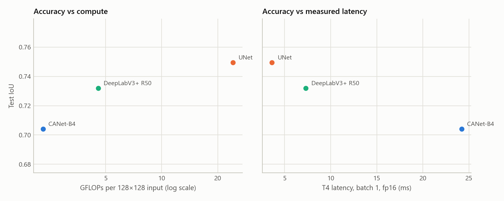

# Results: CANet-B4 against the NWRD paper's UNet and DeepLabV3+ R50

*Final, 2026-10-20.* CANet-B4, UNet and DeepLabV3+ R50, three seeds each at both scales, under
the protocol in [`protocol.md`](protocol.md). Every number here comes from a file in `results/`
(Appendix). CANet-B4 is "ours" throughout; it is reported as measured, including where it loses.

---

## 1. Bottom line

| | 512px (native resolution) | 128px (the NWRD paper's scale) |
|---|---|---|
| Test IoU, CANet-B4 | 0.729 ± 0.013 | 0.704 ± 0.004 |
| Test IoU, UNet (paper architecture, re-trained) | 0.747 ± 0.012 | 0.749 ± 0.009 |
| Test IoU, DeepLabV3+ R50 | 0.739 ± 0.021 | 0.732 ± 0.005 |
| CANet-B4 − UNet, 95% CI (resampling photographs) | −0.019 [−0.042, +0.019] | −0.045 [−0.081, −0.006] |
| CANet-B4 − DeepLabV3+ R50, 95% CI (resampling photographs) | −0.011 [−0.024, +0.008] | −0.028 [−0.054, −0.003] |
| Pre-registered verdict against UNet | **comparable** | **worse** |
| Pre-registered verdict against DeepLabV3+ R50 | **comparable** | **worse** |
| GFLOPs per input, CANet-B4 / UNet / DeepLabV3+ R50 | 36.9 / 385.3 / 73.1 | 2.3 / 24.1 / 4.6 |

1. **Accuracy.** CANet-B4 does not segment rust more accurately than either baseline. At 512px
   the differences are within test-set noise (*comparable*), although CANet-B4 is lower on all
   three seeds against both. At the paper's 128px scale it is significantly worse than both
   (photograph CIs below 0; seed-level t-test p = 0.030 against UNet, 0.013 against DeepLabV3+).
2. **Efficiency.** CANet-B4 needs a tenth of UNet's computation and half of DeepLabV3+ R50's at
   any input size. Against UNet that makes it faster on every device at 512px, but at 128px only
   when batched and on the CPU. DeepLabV3+ R50 is faster than CANet-B4 on every device at both
   scales (§6).
3. **The published baseline.** CANet-B4 far exceeds the paper's published figures (F1 0.826 vs
   0.557 at the paper's scale), but so do the paper's UNet architecture and DeepLabV3+ R50 when
   re-trained under this protocol (F1 0.857 and 0.845). The gain over the published numbers is
   therefore not due to CANet-B4's architecture. It reflects differences in protocol and in the
   photographs themselves, which are not those of the public NWRD release
   ([`protocol.md`](protocol.md) §3.1; §4).

---

## 2. Main experiment: 512px

Test split: 10 photographs, 960 patches, 266 with rust, 8.0% rust pixels. Threshold chosen per run
on validation; metrics pooled over all test pixels; mean ± sample standard deviation over seeds.

| Model | Seeds | IoU | Dice / F1 | Precision | Recall | IoU at 0.5 | IoU, rust patches only |
|---|---|---|---|---|---|---|---|
| **CANet-B4 (ours)** | 3 | 0.729 ± 0.013 | 0.843 ± 0.009 | 0.840 ± 0.012 | 0.846 ± 0.015 | 0.713 ± 0.010 | 0.785 ± 0.013 |
| UNet (paper architecture) | 3 | **0.747** ± 0.012 | **0.855** ± 0.008 | 0.835 ± 0.013 | **0.877** ± 0.002 | **0.721** ± 0.023 | **0.790** ± 0.007 |
| DeepLabV3+ R50 | 3 | 0.739 ± 0.021 | 0.850 ± 0.014 | 0.834 ± 0.043 | 0.869 ± 0.023 | 0.719 ± 0.027 | 0.786 ± 0.013 |
| UNet, lr 1e-3 (control) | 1 | 0.616 | 0.763 | 0.685 | 0.861 | 0.616 | 0.728 |

| CANet-B4 minus | ΔIoU | 95% CI, photographs (p) | 95% CI, patches | ΔDice (95% CI, photographs) | Seed t-test p | CANet-B4 higher | Verdict |
|---|---|---|---|---|---|---|---|
| UNet | −0.019 | [−0.042, +0.019] (0.26) | [−0.042, +0.003] | −0.013 [−0.028, +0.013] | 0.20 | 0 of 3 seeds | comparable |
| DeepLabV3+ R50 | −0.011 | [−0.024, +0.008] (0.21) | [−0.031, +0.007] | −0.007 [−0.017, +0.005] | 0.16 | 0 of 3 seeds | comparable |

- **The UNet baseline.** The shared-lr `unet` beat the `unet_tuned` control on validation in every
  session (0.820 vs 0.798), so `unet` is the paper-architecture baseline. The control also
  collapsed late in training, predicting no rust from epoch 23 of its run.
- **Weighting photographs equally** instead of pooling pixels, the three models tie: mean
  per-photograph IoU 0.750 (CANet-B4), 0.752 (UNet), 0.752 (DeepLabV3+). CANet-B4 is better than
  UNet on 4 of the 10 test photographs, and than DeepLabV3+ on 4.
- **Without threshold tuning** (fixed 0.5), every model loses 0.016–0.026 IoU and the ranking is
  unchanged.

---

## 3. The paper's scale: 128px

Each 512px patch halved (Lanczos) and cut into 2×2 tiles of 128px: the paper's patch size and
downsampling. Test split: the same 10 photographs, 3,840 tiles, 722 with rust, 8.1% rust pixels.

| Model | Seeds | IoU | Dice / F1 | Precision | Recall | IoU at 0.5 | IoU, rust tiles only | IoU per seed |
|---|---|---|---|---|---|---|---|---|
| **CANet-B4 (ours)** | 3 | 0.704 ± 0.004 | 0.826 ± 0.003 | 0.817 ± 0.019 | 0.837 ± 0.013 | 0.684 ± 0.008 | 0.778 ± 0.008 | 0.701, 0.702, 0.709 |
| UNet (paper architecture) | 3 | **0.749** ± 0.009 | **0.857** ± 0.006 | **0.850** ± 0.012 | **0.863** ± 0.006 | **0.731** ± 0.010 | **0.798** ± 0.003 | 0.758, 0.752, 0.739 |
| DeepLabV3+ R50 | 3 | 0.732 ± 0.005 | 0.845 ± 0.003 | 0.844 ± 0.014 | 0.846 ± 0.010 | 0.718 ± 0.007 | 0.789 ± 0.006 | 0.735, 0.726, 0.735 |

| CANet-B4 minus | ΔIoU | 95% CI, photographs (p) | 95% CI, tiles | ΔDice (95% CI, photographs) | Seed t-test p | CANet-B4 higher | Verdict |
|---|---|---|---|---|---|---|---|
| UNet | −0.045 | [−0.081, −0.006] (0.028) | [−0.061, −0.030] | −0.030 [−0.056, −0.004] | 0.030 | 0 of 3 seeds | worse |
| DeepLabV3+ R50 | −0.028 | [−0.054, −0.003] (0.033) | [−0.043, −0.014] | −0.019 [−0.035, −0.002] | 0.013 | 0 of 3 seeds | worse |

- **Weighting photographs equally**, CANet-B4 is still last: mean per-photograph IoU 0.717
  (CANet-B4), 0.748 (UNet), 0.750 (DeepLabV3+). CANet-B4 is better than UNet on 3 of the 10 test
  photographs, and than DeepLabV3+ on 1.
- **Without threshold tuning** (fixed 0.5), every model loses 0.014–0.020 IoU and the ranking is
  unchanged.
- **DeepLabV3+ R50 was added later** (2026-10-18): same protocol, data and settings, but its
  augmentation was seeded, unlike the earlier runs (`results/README.md`).

**Effect of scale.** Going from 512px to 128px costs CANet-B4 0.024 IoU and DeepLabV3+ R50 0.007
(well within its seed spread at 512px), and leaves UNet unchanged (0.747 → 0.749). At 128px
CANet-B4's deepest feature map is 4×4, so two of its three context flows pool the whole map and its
context module can add little ([`protocol.md`](protocol.md) §2.1). The architecture is being run
below the scale it was designed for.

---

## 4. Against the paper's published numbers

These rows are context, not a paired comparison: the paper's photographs (the public NWRD
release; ours are not from it, [`protocol.md`](protocol.md) §3.1), its training (APF, RMSprop at
lr 1e-6, 500 epochs, focal loss) and its metric averaging all differ from ours.

| Source | Test set | Precision | Recall | F1 / Dice | IoU |
|---|---|---|---|---|---|
| NWRD paper: UNet + APF (Table 3) | full test set | 0.506 | 0.624 | 0.557 | – |
| CANet-B4, 128px | all test tiles | 0.817 | 0.837 | 0.826 | 0.704 |
| UNet re-trained here, 128px | all test tiles | 0.850 | 0.863 | 0.857 | 0.749 |
| DeepLabV3+ R50, 128px | all test tiles | 0.844 | 0.846 | 0.845 | 0.732 |
| NWRD paper: UNet + APF (Table 4) | background-only patches removed | 0.593 | 0.552 | 0.564 | 0.438 |
| CANet-B4, 128px | rust tiles only | 0.918 | 0.837 | 0.875 | 0.778 |
| UNet re-trained here, 128px | rust tiles only | 0.914 | 0.863 | 0.888 | 0.798 |
| DeepLabV3+ R50, 128px | rust tiles only | 0.921 | 0.846 | 0.882 | 0.789 |

All three re-trained models far exceed the published figures at the paper's own scale. Because the
paper's architecture, trained from scratch under our protocol, does as well as or better than
CANet-B4, **the gain over the published numbers is not due to CANet-B4's architecture**. It comes
from differences that this study cannot separate: optimiser and learning rate, loss,
augmentation, a threshold chosen on validation, pooled rather than per-image metrics, and the
photographs themselves. These are not just another test split but another collection, all from
one DSLR, where two-thirds of the release's photographs come from a phone. The paper's own
Table 4 F1 and IoU are not consistent as pooled values ([`paper_summary.md`](paper_summary.md)
§6), which is another reason not to compare decimals.

---

## 5. Where the models differ (512px)

### 5.1 By lesion size

Test patches binned by their share of rust pixels; scores pooled within each bin, mean over seeds.

| Rust share of the patch | Patches | Share of all rust pixels | IoU: CANet-B4 / UNet / DLv3+ | Recall | Precision |
|---|---|---|---|---|---|
| < 1% | 22 | 0.1% | 0.111 / **0.172** / 0.132 | 0.471 / **0.595** / 0.555 | 0.128 / **0.196** / 0.154 |
| 1–5% | 27 | 1.0% | **0.460** / 0.454 / 0.442 | 0.663 / **0.807** / 0.787 | **0.601** / 0.510 / 0.507 |
| 5–20% | 65 | 9.6% | **0.690** / 0.633 / 0.657 | 0.785 / **0.803** / 0.797 | **0.851** / 0.749 / 0.793 |
| > 20% | 152 | 89.3% | 0.804 / **0.818** / 0.812 | 0.855 / **0.886** / 0.878 | **0.931** / 0.914 / 0.916 |

On rust-free patches (694), CANet-B4 raises a visible false alarm (at least 0.1% of the patch
predicted as rust) on 9.6% of them, against 12.5% for UNet and 10.1% for DeepLabV3+.

CANet-B4 is the most conservative model: the highest precision on every lesioned bin but the
smallest, and the lowest recall in every bin. That makes it the best model on medium lesions
(1–20% of a patch) and the most reluctant to raise false alarms. But patches more than 20% rust
hold 89% of all rust pixels, and there it under-segments, which decides the pooled IoU. Its
1/4-resolution head and single skip connection are a plausible cause, not a tested one. The
figure is `results/analysis/512px/lesion_size.png`:

At 128px both baselines match or beat CANet-B4's IoU in every bin. False alarms on rust-free tiles
are 6.8% for CANet-B4, 7.0% for UNet and 4.8% for DeepLabV3+ R50 (`results/analysis/128px/`).

### 5.2 By test photograph

No model wins consistently. Per-photograph IoU ranges from 0.57 to 0.83 for CANet-B4 and from 0.53
to 0.87 for UNet. That spread across photographs is far larger than the gaps between models, which
is why the confidence intervals resample photographs.

### 5.3 Training behaviour and threshold sensitivity

| | CANet-B4 | UNet | DeepLabV3+ R50 |
|---|---|---|---|
| Best epoch (seeds 42, 43, 44) | 12, 9, 23 | 28, 30, 30 | 17, 12, 16 |
| Validation IoU at 0.5: best → final epoch | 0.79–0.83 → 0.72–0.76 | 0.81–0.82 → 0.80–0.82 | 0.81–0.82 → 0.76–0.79 |
| Val-selected threshold (seeds) | 0.76, 0.76, 0.86 | 0.76, 0.68, 0.66 | 0.69, 0.81, 0.60 |
| Training time (min/epoch, T4) | 3.2 | 6.6 | 2.1 |

The pretrained models peak early and then overfit; model selection on validation keeps their best
epoch. UNet, trained from scratch, is still improving at epoch 30. Validation IoU is flat near
every chosen threshold: it changes by at most 0.017 within ±0.10 of it.

---

## 6. Efficiency

Measured on one Tesla T4 (PyTorch 2.10, random weights, median of 100 timed runs) and Kaggle's
2-thread CPU (median of 10); FLOPs count a multiply-add as 2. Each table was measured in a single
session, every model in it together.

### 6.1 At 512px

| Model | Params (M) | GFLOPs | T4 fp32, bs 1 (ms) | T4 fp16, bs 1 (ms) | T4 fp16 throughput, bs 8 (img/s) | Peak memory, bs 8 (MB) | CPU, bs 1 (ms) | Train (min/epoch) |
|---|---|---|---|---|---|---|---|---|
| **CANet-B4** | 29.4 | **36.9** | 30.6 | 26.3 | 72.6 | **744** | 725 | 3.2 |
| UNet | 31.0 | 385.3 | 94.9 | 40.1 | 28.0 | 1,874 | 3,157 | 6.6 |
| DeepLabV3+ R50 | 26.7 | 73.1 | **27.3** | **10.8** | **95.4** | 835 | **579** | **2.1** |

- **Against UNet, CANet-B4 is cheaper on every measure:** 10.4× fewer FLOPs, 3.1× lower fp32
  latency, 2.6× the fp16 throughput, 2.5× less memory, 4.4× faster on the CPU, and training epochs
  half as long.
- **Against DeepLabV3+ R50, fewer FLOPs do not mean faster.** CANet-B4 needs half the FLOPs but is
  2.4× slower in fp16 on the T4, 1.1× slower in fp32 and 1.25× slower on the CPU. A plausible
  reason, not profiled here: EfficientNet's depthwise convolutions and squeeze-and-excitation
  blocks are memory-bound and gain little from tensor cores, which ResNet-50's dense convolutions
  use well.
- **The saving comes from the encoder, not the context module.** A DeepLabV3+ with the same
  EfficientNet-B4 encoder (`deeplabv3plus_b4`, not trained) costs 35.7 GFLOPs, about the same as
  CANet-B4's 36.9 (measured with `nwrd.benchmark.count_flops`).

### 6.2 At 128px

| Model | GFLOPs | T4 fp32, bs 1 (ms) | T4 fp16, bs 1 (ms) | fp16 throughput, bs 8 / bs 64 (img/s) | Peak memory, bs 64 (MB) | CPU, bs 1 (ms) | Train (min/epoch) |
|---|---|---|---|---|---|---|---|
| **CANet-B4** | **2.3** | 22.6 | 24.2 | 309 / 869 | **646** | 67 | 3.1 |
| UNet | 24.1 | 7.2 | **3.6** | 474 / 524 | 1,540 | 156 | 1.7 |
| DeepLabV3+ R50 | 4.6 | **6.3** | 7.3 | **987** / **1,323** | 802 | **57** | **1.2** |

At this size the GPU is dominated by per-layer overhead, not arithmetic. CANet-B4 is about 30
blocks deep, so on single tiles it is 6.7× slower than UNet in fp16, and it trains 1.8× slower per
epoch at batch 8. Only at batch 64 does its lower FLOP count beat UNet (1.7× the throughput, 2.4×
less memory); on the CPU it is 2.3× faster than UNet. DeepLabV3+ R50 is faster than CANet-B4 on
every measure: 3.6× lower fp32 latency, 3.2× the fp16 throughput at batch 8 and 1.5× at batch 64,
1.2× faster on the CPU, and epochs 2.7× shorter. Beyond FLOPs, CANet-B4's one advantage at this
scale is the smallest memory footprint at batch 64.

### 6.3 Per photograph

For one 6016×4000 photograph (96 native 512px patches, or 384 tiles of 128px at 0.5×, padding
included):

| Scale | Model | TFLOPs | T4 fp16, batched (s) | CPU, bs 1 (s) |
|---|---|---|---|---|
| 512px | CANet-B4 | 3.54 | 1.32 | 69.6 |
| 512px | UNet | 36.99 | 3.43 | 303.1 |
| 512px | DeepLabV3+ R50 | 7.02 | 1.01 | 55.6 |
| 128px | CANet-B4 | 0.89 | 0.44 | 25.7 |
| 128px | UNet | 9.25 | 0.73 | 60.0 |
| 128px | DeepLabV3+ R50 | 1.76 | 0.29 | 21.9 |

---

## 7. How large is run-to-run noise?

The first Kaggle session of the main experiment ran the same protocol, data and seeds before it
was cut off (`results/512px/replicate/`); the final runs were trained from scratch in later
sessions. Test IoU for identical seeds:

| Run | Session 1 | Final | Difference |
|---|---|---|---|
| CANet-B4, seed 42 | 0.726 | 0.718 | 0.008 |
| CANet-B4, seed 43 | 0.716 | 0.744 | **0.028** |
| UNet, seed 42 | 0.731 | 0.737 | 0.005 |
| DeepLabV3+ R50, seed 42 | 0.729 | 0.719 | 0.010 |
| UNet lr 1e-3, seed 42 | 0.658 | 0.616 | 0.042 |

A seed does not pin a result down: GPU nondeterminism and, in these runs, unseeded augmentation
(`results/README.md`) move test IoU by up to 0.028 for CANet-B4. That is larger than its 0.019 gap
to UNet at 512px. Differences between single runs below about 0.03 IoU therefore carry no
information, and the verdicts rest on three seeds and the photograph bootstrap.

---

## 8. Results by model

Sections 2–6 set the models side by side. Here each model's results are gathered on their own,
at both scales. Every seed and metric of one model at one scale is in
`results/<scale>/final/<model>/summary.md`, linked in each table.

### 8.1 CANet-B4 (ours)

EfficientNet-B4 encoder (ImageNet-pretrained), CAM context module and asymmetric decoder;
29.4 M parameters ([`protocol.md`](protocol.md) §2).

| | 512px | 128px |
|---|---|---|
| Test IoU (seeds 42, 43, 44) | 0.729 ± 0.013 (0.718, 0.744, 0.724) | 0.704 ± 0.004 (0.701, 0.702, 0.709) |
| Dice / precision / recall | 0.843 / 0.840 / 0.846 | 0.826 / 0.817 / 0.837 |
| Best epoch (seeds) | 12, 9, 23 | 13, 11, 10 |
| Val-selected threshold (seeds) | 0.76, 0.76, 0.86 | 0.75, 0.65, 0.75 |
| GFLOPs; T4 fp16, bs 1; CPU, bs 1 | 36.9; 26.3 ms; 725 ms | 2.3; 24.2 ms; 67 ms |
| Training (min/epoch) | 3.2 | 3.1 |
| Every seed and metric | [`512px/final/canet_b4/summary.md`](../results/512px/final/canet_b4/summary.md) | [`128px/final/canet_b4/summary.md`](../results/128px/final/canet_b4/summary.md) |

At 512px it has the highest precision and the lowest recall of the three models: it is the most
conservative, and it under-segments the large lesions that hold most rust pixels (§5.1). It peaks
early and then overfits (§5.3). Halving the scale costs it 0.024 IoU, the most of the three (§3).
It needs the fewest FLOPs at both scales, but is not the fastest model at either (§6).

### 8.2 UNet (the NWRD paper's architecture)

Four encoder and four decoder blocks, trained from scratch under this protocol; 31.0 M parameters.

| | 512px | 128px |
|---|---|---|
| Test IoU (seeds 42, 43, 44) | 0.747 ± 0.012 (0.737, 0.746, 0.760) | 0.749 ± 0.009 (0.758, 0.752, 0.739) |
| Dice / precision / recall | 0.855 / 0.835 / 0.877 | 0.857 / 0.850 / 0.863 |
| CANet-B4 against it | comparable: ΔIoU −0.019 [−0.042, +0.019] | worse: ΔIoU −0.045 [−0.081, −0.006] |
| Best epoch (seeds) | 28, 30, 30 | 23, 21, 21 |
| Val-selected threshold (seeds) | 0.76, 0.68, 0.66 | 0.60, 0.69, 0.66 |
| GFLOPs; T4 fp16, bs 1; CPU, bs 1 | 385.3; 40.1 ms; 3,157 ms | 24.1; 3.6 ms; 156 ms |
| Training (min/epoch) | 6.6 | 1.7 |
| Every seed and metric | [`512px/final/unet/summary.md`](../results/512px/final/unet/summary.md) | [`128px/final/unet/summary.md`](../results/128px/final/unet/summary.md) |

The highest test IoU at both scales, and unchanged by the change of scale (0.747 → 0.749). At
512px its best epochs are the last ones, so the shared 30-epoch schedule may under-train it
(§10). Its cost profile is the opposite of CANet-B4's: 10.4× the FLOPs and the slowest model at
512px, yet at 128px the fastest at batch 1 in fp16 (§6).

### 8.3 DeepLabV3+ R50

The standard DeepLabV3+ of segmentation-models-pytorch 0.5.0 with an ImageNet-pretrained
ResNet-50; 26.7 M parameters. It stands in for the internship's "Custom DeepLabV3+", whose code
was not preserved ([`protocol.md`](protocol.md) §1).

| | 512px | 128px |
|---|---|---|
| Test IoU (seeds 42, 43, 44) | 0.739 ± 0.021 (0.719, 0.760, 0.738) | 0.732 ± 0.005 (0.735, 0.726, 0.735) |
| Dice / precision / recall | 0.850 / 0.834 / 0.869 | 0.845 / 0.844 / 0.846 |
| CANet-B4 against it | comparable: ΔIoU −0.011 [−0.024, +0.008] | worse: ΔIoU −0.028 [−0.054, −0.003] |
| Best epoch (seeds) | 17, 12, 16 | 8, 10, 16 |
| Val-selected threshold (seeds) | 0.69, 0.81, 0.60 | 0.68, 0.72, 0.72 |
| GFLOPs; T4 fp16, bs 1; CPU, bs 1 | 73.1; 10.8 ms; 579 ms | 4.6; 7.3 ms; 57 ms |
| Training (min/epoch) | 2.1 | 1.2 |
| Every seed and metric | [`512px/final/deeplabv3plus_r50/summary.md`](../results/512px/final/deeplabv3plus_r50/summary.md) | [`128px/final/deeplabv3plus_r50/summary.md`](../results/128px/final/deeplabv3plus_r50/summary.md) |

Second in test IoU at both scales. Although it needs twice CANet-B4's FLOPs, it is the fastest
model on every measure at both scales, except fp16 latency at batch 1 at 128px, where UNet is
faster, and the quickest to train (§6). Its 128px runs were trained last, with seeded
augmentation (§3).

### 8.4 UNet with lr 1e-3 (control)

Not a baseline: the `unet` architecture with its own learning rate (1e-3), run once at 512px to
check that the shared learning rate does not handicap a network trained from scratch. It was not
run at 128px.

| | 512px, seed 42 |
|---|---|
| Test IoU | 0.616 |
| Dice / precision / recall | 0.763 / 0.685 / 0.861 |
| Validation IoU | 0.798 (`unet`: 0.820) |
| Best epoch; val-selected threshold | 22; 0.50 |
| Training (min/epoch) | 7.0 |
| Every metric | [`512px/final/unet_tuned/summary.md`](../results/512px/final/unet_tuned/summary.md) |

Its validation IoU stayed below `unet`'s in every session, and from epoch 23 it predicted no rust
at all, so `unet` is the baseline (§2). CANet-B4 is better than it by 0.102 IoU (95% CI
[+0.006, +0.189], resampling photographs), but with one seed the rule's condition of winning on 2
of 3 seeds cannot be met, so its formal verdict is *comparable*.

---

## 9. What can be claimed

Supported by these results:

- *"Trained and evaluated under an identical protocol with three seeds, CANet-B4 reaches test IoU
  0.729 ± 0.013 on 512px patches, comparable to the NWRD paper's UNet architecture (0.747 ± 0.012;
  ΔIoU −0.019, 95% CI [−0.042, +0.019] resampling test photographs) and to DeepLabV3+ R50
  (0.739 ± 0.021)."*
- *"At the paper's own 128px scale, CANet-B4 is less accurate than the paper's UNet architecture
  (0.704 ± 0.004 vs 0.749 ± 0.009; ΔIoU −0.045, 95% CI [−0.081, −0.006]) and than DeepLabV3+ R50
  (0.732 ± 0.005; ΔIoU −0.028, 95% CI [−0.054, −0.003])."*
- *"CANet-B4 needs 10.4× fewer FLOPs than the paper's UNet at any input size. At 512px it runs 3.1×
  faster on a T4 GPU (fp32, batch 1) and 4.4× faster on a CPU, with 2.5× less GPU memory."*
- *"CANet-B4, the paper's re-trained UNet and DeepLabV3+ R50 all exceed the paper's published
  scores by a wide margin, on different photographs, so that margin is not due to CANet-B4's
  architecture."*

Not supported, and not claimed:

- That CANet-B4 is more accurate than either baseline.
- That the models would score the same on the public NWRD release, or that the protocol alone
  explains the margin over the published scores: the photographs differ.
- That CANet-B4 is faster than DeepLabV3+ R50, or that its context module is what makes it cheap.
- That CANet-B4 beats the paper's full method (UNet + APF): APF was not reproduced.
- Anything finer than 10 test photographs can resolve.

---

## 10. Limitations

1. **Ten test photographs, five for validation.** They bound the precision of every estimate.
2. **Not the public NWRD photographs.** The 100 photographs (one DSLR, 6016×4000, March 2023) are
   not those of the NWRD release (two-thirds phone photographs, 2022). They come from the Kaggle
   dataset `manan369/nwrd-f`, which does not say where they were taken
   ([`protocol.md`](protocol.md) §3.1). The comparison among the three models is unaffected,
   but whether its results hold on the release, or on phone photographs, is untested.
3. **One shared schedule.** The pretrained models peak between epochs 8 and 23 and then overfit,
   while the from-scratch UNet is still improving at epoch 30 at 512px (its best epochs are 21–23
   at 128px). A longer schedule would more likely help UNet than CANet-B4.
4. **Pretraining is folded into "architecture",** and the same-encoder ablation that would
   separate encoder from context module was not trained.
5. **APF is not reproduced.**
6. **Compression robustness is untested.** The training patches are lossless PNG crops of the
   camera's JPEGs, decoded once. In a smoke test of the app on one rust-heavy 1024×1024 region of
   test photograph 100, re-encoding it as JPEG at quality 95 (a mean change of 0.8 grey levels)
   lowered the share predicted as rust from 61% to 49%. One region is anecdotal, but uploaded
   photographs are often re-compressed, so this needs a test-set evaluation before deployment.
7. **Efficiency was measured on one GPU type (T4) and one CPU type.**

---

## Appendix: where every number comes from

| Numbers | Source |
|---|---|
| §1–3 accuracy, significance and verdicts | `results/512px/final/comparison.json` and `results/128px/final/comparison.json` (`summary`, `significance`) |
| §8 results by model | `results/<scale>/final/<model>/summary.md`, written with `comparison.json` from the same files |
| Per-photograph, lesion size, false alarms, training, thresholds | `results/analysis/512px/analysis.json`, `results/analysis/128px/analysis.json` (`scripts/analyse_results.py`) |
| Effect of scale, per-photograph cost | `results/analysis/scales.md` (`scripts/compare_scales.py`) |
| The photographs and the release they are compared with | [`protocol.md`](protocol.md) §3.1–3.2, checked with `scripts/verify_dataset.py` and the release's archive |
| Efficiency | `results/512px/final/benchmark.json`, `results/128px/final/benchmark.json`; training time from each run's `history.json` |
| Run-to-run noise | `results/512px/replicate/log.txt` against `results/512px/final/` (`analysis.json`, `replicate`) |
| Paper figures | Anwar et al. 2023, Tables 3 and 4 ([`paper_summary.md`](paper_summary.md)) |
| DeepLabV3+ B4 FLOPs | `nwrd.benchmark.count_flops(build_model('deeplabv3plus_b4', pretrained=False), 512, cpu)`, run 2026-10-17 |
| JPEG observation | App smoke test, 2026-10-17 (not part of the results folders) |
